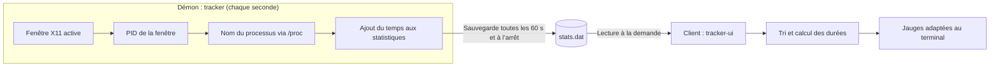
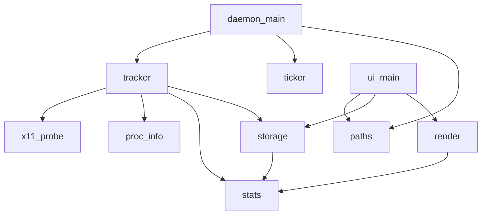

# Time Tracker

Petit démon Linux en C qui mesure le temps passé sur chaque application, accompagné d’un client en terminal pour consulter les statistiques.

```text
Application active : brave
Temps enregistré   : 37 min 08 s
Part du temps suivi : 33 %
```

Le projet a deux objectifs : fournir un outil utile au quotidien et servir de support d’apprentissage de la programmation système en C (appels système, `/proc`, Xlib, signaux, fichiers et mémoire dynamique).

> **Compatibilité :** Linux avec une session graphique X11. Wayland n’est pas pris en charge.

## Sommaire

- [Fonctionnement](#fonctionnement)
- [Prérequis](#prérequis)
- [Compilation et tests](#compilation-et-tests)
- [Installation comme service](#installation-comme-service)
- [Afficher les statistiques à l’ouverture du terminal](#afficher-les-statistiques-à-louverture-du-terminal)
- [Utilisation](#utilisation)
- [Configuration et données](#configuration-et-données)
- [Architecture](#architecture)
- [Format du fichier de données](#format-du-fichier-de-données)
- [Principes de conception](#principes-de-conception)
- [Dépannage](#dépannage)
- [Limites connues](#limites-connues)
- [Pistes d’évolution](#pistes-dévolution)

## Fonctionnement

Le projet se compose de deux programmes indépendants qui échangent par un fichier de données :



- **`tracker`** interroge X11 chaque seconde pour identifier la fenêtre au premier plan. Il récupère son PID, lit son nom dans `/proc/<pid>/comm` et comptabilise le temps par application.
- Les statistiques sont sauvegardées toutes les 60 secondes et à l’arrêt normal du démon (`SIGTERM` ou `SIGINT`). Elles sont conservées entre les lancements.
- **`tracker-ui`** lit le fichier de données et affiche les statistiques sous forme de jauges. Il ne dépend pas de X11.

## Prérequis

| Élément | Prérequis |
| --- | --- |
| Système | Linux (développé sous Ubuntu) |
| Session graphique | X11 / Xorg |
| Compilation | GCC compatible C11 et GNU Make |
| Bibliothèque | Xlib (`libx11-dev`), nécessaire au démon uniquement |
| Tests | Valgrind |
| Service utilisateur | systemd |

Sur Debian ou Ubuntu, installez les outils nécessaires :

```bash
sudo apt install build-essential libx11-dev valgrind gdb
```

Vérifiez que la session utilise X11 :

```bash
echo "$XDG_SESSION_TYPE"  # doit afficher x11
```

Si nécessaire, sélectionnez **Ubuntu sur Xorg** depuis l’écran de connexion.

## Compilation et tests

Depuis la racine du dépôt :

```bash
make        # compile build/tracker et build/tracker-ui
make test   # compile les tests et les exécute sous Valgrind
make run    # compile puis lance le démon au premier plan
make clean  # supprime le dossier build/
```

Les tests unitaires sont dans `tests/`. Ils couvrent les statistiques, le stockage, les chemins et le rendu. La cible `make test` échoue en cas d’erreur Valgrind ou de fuite mémoire.

Les options de compilation comprennent `-Wall -Wextra -Wpedantic -g -std=c11`. L’objectif est de compiler sans avertissement.

## Installation comme service

Le service systemd utilisateur lance le démon à l’ouverture de la session graphique ; aucun `sudo` n’est requis pour ces commandes.

### 1. Créer le fichier de service

Créez `~/.config/systemd/user/timetracker.service` (un exemple est fourni dans `packaging/timetracker.service`) :

```ini
[Unit]
Description=Time tracker (temps passé par application)
After=graphical-session.target
PartOf=graphical-session.target

[Service]
ExecStart=/chemin/absolu/vers/time-tracker-linux-X11/build/tracker
Restart=on-failure
RestartSec=5

[Install]
WantedBy=graphical-session.target
```

Remplacez `ExecStart` par le chemin absolu vers le binaire `build/tracker` sur votre machine.

### 2. Vérifier l’environnement graphique

Le démon a besoin de la variable `DISPLAY` pour se connecter à X11 :

```bash
systemctl --user show-environment | grep -E 'DISPLAY|XAUTHORITY'
```

Si ces variables ne sont pas présentes, importez-les :

```bash
systemctl --user import-environment DISPLAY XAUTHORITY
```

### 3. Activer et démarrer le service

```bash
systemctl --user daemon-reload
systemctl --user enable --now timetracker.service
systemctl --user status timetracker.service
```

L’état attendu est `active (running)`. `Restart=on-failure` demande à systemd de relancer le démon après une sortie en erreur, avec une attente de cinq secondes.

## Afficher les statistiques à l’ouverture du terminal

Pour afficher le résumé à l’ouverture d’un terminal Bash interactif, ajoutez ceci à `~/.bashrc` en remplaçant le chemin du binaire :

```bash
# Résumé Time Tracker à l’ouverture d’un terminal interactif
if [ -t 1 ] && [ -x /chemin/absolu/vers/time-tracker-linux-X11/build/tracker-ui ]; then
    /chemin/absolu/vers/time-tracker-linux-X11/build/tracker-ui
fi
```

`[ -t 1 ]` évite l’affichage dans les scripts et les commandes sans terminal. `[ -x ... ]` évite une erreur si le binaire n’existe pas. Si Bash est lancé comme shell de connexion et que le résumé n’apparaît pas, vérifiez que `~/.bash_profile` ou `~/.profile` charge `~/.bashrc`.

## Utilisation

```bash
./build/tracker-ui

systemctl --user status timetracker.service
systemctl --user stop timetracker.service      # arrêt propre et sauvegarde
systemctl --user start timetracker.service
systemctl --user restart timetracker.service    # après recompilation

journalctl --user-unit timetracker.service -n 20 --no-pager
cat "${XDG_DATA_HOME:-$HOME/.local/share}/timetracker/stats.dat"
```

Après recompilation, redémarrez le service : un processus déjà lancé continue d’utiliser l’ancien binaire chargé en mémoire. Ne lancez pas `./build/tracker` manuellement pendant que le service tourne : les deux démons écriraient dans le même fichier.

Le client affiche l’état de la dernière sauvegarde. Les chiffres peuvent donc avoir jusqu’à une minute de retard.

## Configuration et données

Le projet ne possède pas de fichier de configuration. Les réglages sont définis dans le code ; après modification, recompilez et redémarrez le démon si nécessaire.

| Constante | Fichier | Rôle | Valeur par défaut |
| --- | --- | --- | --- |
| `SAVE_INTERVAL` | `src/daemon_main.c` | Intervalle entre les sauvegardes périodiques | `60u` secondes |
| `MIN_PERCENT` | `src/render.c` | Pourcentage minimal affiché | `1` % |
| `MAX_BAR` | `src/render.c` | Largeur maximale d’une jauge | `50` colonnes |
| `MIN_BAR` | `src/render.c` | Largeur minimale d’une jauge | `10` colonnes |
| `MIN_WIDTH` | `src/render.c` | Largeur minimale de terminal prise en compte | `40` colonnes |

Les statistiques sont enregistrées dans `$XDG_DATA_HOME/timetracker/stats.dat` si `XDG_DATA_HOME` est défini, sinon dans `~/.local/share/timetracker/stats.dat`. Les répertoires de données sont créés avec les permissions `0700`.

## Architecture

### Organisation des fichiers

```text
time-tracker-linux-X11/
├── Makefile
├── Readme.md
├── packaging/
│   └── timetracker.service
├── src/
│   ├── daemon_main.c       # démon : assemblage, signaux et boucle
│   ├── ui_main.c           # client terminal
│   ├── x11_probe.[ch]      # identification de la fenêtre active (X11)
│   ├── proc_info.[ch]      # lecture du nom du processus dans /proc
│   ├── stats.[ch]          # table application → secondes
│   ├── storage.[ch]        # chargement et sauvegarde
│   ├── paths.[ch]          # chemins XDG
│   ├── tracker.[ch]        # logique de suivi et persistance
│   ├── ticker.[ch]         # boucle périodique
│   └── render.[ch]         # affichage des statistiques
└── tests/
    ├── test_stats.c
    ├── test_storage.c
    ├── test_paths.c
    └── test_render.c
```

### Dépendances entre modules



Les dépendances vont dans un seul sens, sans cycle. Seul le démon est lié à Xlib ; `tracker-ui` peut fonctionner sans serveur X11.

### Responsabilités principales

| Module | Responsabilité |
| --- | --- |
| `x11_probe` | Récupère le PID de la fenêtre active via `_NET_ACTIVE_WINDOW` et `_NET_WM_PID`. L’absence de fenêtre active est un cas normal. |
| `proc_info` | Lit `/proc/<pid>/comm` dans un tampon fourni par l’appelant. Le noyau limite ce nom à 15 caractères. |
| `stats` | Gère la table dynamique des applications et de leur durée. |
| `storage` | Charge et sauvegarde les statistiques ; l’écriture est atomique via un fichier temporaire puis `rename`. |
| `paths` | Détermine le chemin XDG et crée les répertoires nécessaires. |
| `tracker` | Coordonne la sonde, les statistiques et la persistance, sans afficher de sortie. |
| `ticker` | Exécute un callback périodique, notamment jusqu’à la réception d’un signal d’arrêt. |
| `render` | Trie les statistiques, calcule les jauges et formate les durées. Écrit dans un `FILE *`. |
| `daemon_main` | Installe les gestionnaires `SIGINT`/`SIGTERM`, charge les données, démarre la boucle et sauvegarde à l’arrêt. |
| `ui_main` | Charge les données, détecte la largeur du terminal et appelle le rendu. |

### Cycle de vie du démon

```text
Calcul du chemin des données
  → installation des gestionnaires de signaux
  → création du tracker et chargement des statistiques
  → boucle : à chaque seconde, mise à jour de l’application active
  → sauvegarde périodique toutes les 60 secondes
  → SIGTERM ou SIGINT : sortie de boucle, sauvegarde finale et libération
```

## Format du fichier de données

Le fichier est du texte brut, avec un enregistrement par ligne au format `<secondes><TAB><nom>` :

```text
2228<TAB>brave
1592<TAB>wezterm-gui
993<TAB>systemsettings
```

Le fichier peut être consulté avec `cat` et modifié manuellement. Les lignes mal formées sont ignorées au chargement ; les durées chargées s’ajoutent aux valeurs déjà présentes en mémoire.

La sauvegarde est atomique : le contenu est écrit dans `stats.dat.tmp`, puis le fichier temporaire est renommé en `stats.dat`. Une interruption pendant l’écriture laisse ainsi l’ancienne sauvegarde intacte.

## Principes de conception

- Un module correspond à un contrat `.h` et une implémentation `.c` ; les fonctions internes restent privées (`static`).
- Les structures principales sont opaques et manipulées via des fonctions dédiées.
- La propriété mémoire est explicite : les ressources créées ont une fonction de destruction correspondante, qui accepte `NULL`.
- L’état passe par les paramètres ; seul le drapeau de signal est global, conformément à l’usage de `sig_atomic_t`.
- Les erreurs sont signalées par les valeurs de retour et `errno`, sans appeler `exit()` depuis les modules.
- Les ressources sont libérées sur les chemins d’erreur.
- X11 est isolé dans `x11_probe`, et chaque module testable possède un test unitaire.

## Dépannage

| Symptôme | Cause probable | Vérification ou solution |
| --- | --- | --- |
| `make` ne crée pas les exécutables | Compilation interrompue ou outils manquants | Vérifiez la sortie de `make`, puis installez GCC, Make et `libx11-dev`. |
| `*** missing separator` | Espaces au lieu d’une tabulation dans le Makefile | Utilisez une vraie tabulation pour les commandes Make. |
| `undefined reference to XOpenDisplay` | Bibliothèque X11 absente à l’édition de liens | Vérifiez que `libx11-dev` est installé et que le lien du démon utilise `-lX11`. |
| Le démon ne peut pas se connecter à X | `DISPLAY` absent, ou session Wayland | Vérifiez `echo "$DISPLAY"` et `echo "$XDG_SESSION_TYPE"`, puis importez `DISPLAY` dans l’environnement systemd utilisateur. |
| Les chiffres ne changent pas | Service arrêté ou sauvegarde périodique pas encore effectuée | Vérifiez `systemctl --user status timetracker.service` et patientez jusqu’à 60 secondes. |
| Le comportement ne change pas après `make` | Le service utilise encore le binaire chargé précédemment | Exécutez `systemctl --user restart timetracker.service`. |
| Le service échoue après `make clean` | Le binaire a été supprimé | Relancez `make`, puis redémarrez le service. |
| Rien ne s’affiche à l’ouverture d’un terminal | `~/.bashrc` n’est pas chargé ou le binaire est absent | Vérifiez le bloc dans `~/.bashrc`, le chemin et les permissions du binaire. |

## Limites connues

- **X11 uniquement :** Wayland ne permet pas à une application ordinaire d’identifier la fenêtre active. Une intégration Wayland nécessiterait une autre approche, par exemple une extension du shell ou D-Bus.
- **Noms de processus limités :** `/proc/<pid>/comm` est limité à 15 caractères par le noyau.
- **Certaines applications ne sont pas comptées :** leur fenêtre peut ne pas exposer `_NET_WM_PID`, notamment dans certains environnements sandboxés.
- **Pas de détection d’inactivité :** le temps continue d’être compté lorsqu’une fenêtre garde le focus, même si l’utilisateur est absent ou que l’écran est verrouillé.
- **Pas de verrou inter-processus :** deux démons lancés en même temps peuvent écrire dans le même fichier.
- **Retard et perte possibles :** l’affichage peut avoir jusqu’à 60 secondes de retard ; une terminaison forcée peut faire perdre les données depuis la dernière sauvegarde.
- **Horloge approximative :** un tick repose sur `sleep(1)` et ne corrige pas la dérive.

## Pistes d’évolution

- [ ] Ajouter `make install` pour installer les binaires dans `~/.local/bin`.
- [ ] Ajouter un verrou (`flock`) pour empêcher plusieurs démons simultanés.
- [ ] Remplacer le fichier par une socket Unix pour obtenir des statistiques en direct.
- [ ] Ajouter la détection d’inactivité.
- [ ] Mieux gérer les erreurs X11 liées aux fenêtres qui disparaissent.
- [ ] Ajouter des statistiques par jour et une remise à zéro.
- [ ] Utiliser une horloge monotone et mesurer le temps réel écoulé entre les ticks.
- [ ] Étudier une intégration Wayland.

---

Auteur : Diego DELVIG — diegodvg@tutamail.com
